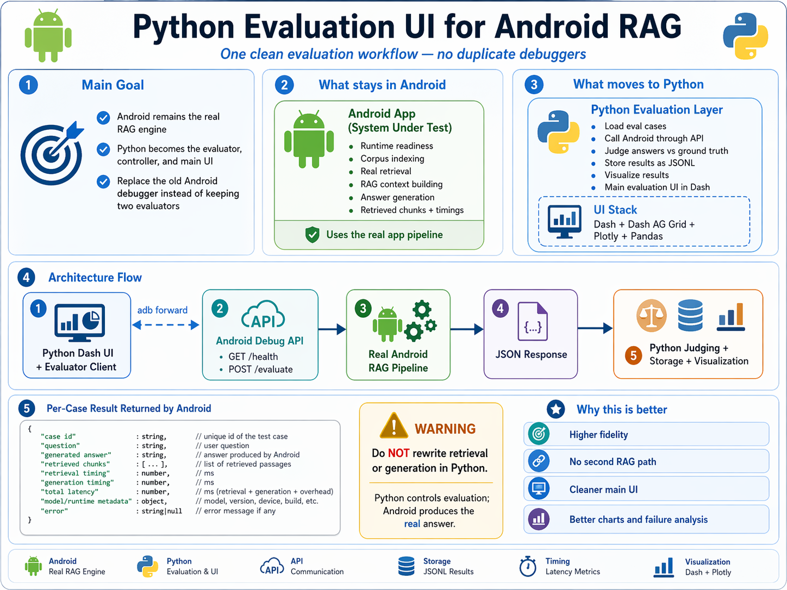

# 🤖 Android RAG Evaluator

**Evaluate the answers, evidence, and latency of your Android RAG application.**

A Python evaluation toolkit for RAG apps running on an Android phone, an emulator, or an HTTP server. Run test questions against your application, optionally score the results with a model API, and explore the exported reports in RAG Evaluation Studio.

[](tools/eval/README.md)
[](#quick-start)
[](https://rag-evaluation-studio.kareem-rag-tools.workers.dev/)

**[🌐 Open the Cloudflare website](https://rag-evaluation-studio.kareem-rag-tools.workers.dev/)** · **[📖 Full setup guide](tools/eval/README.md)** · **[⚙️ Example app profile](tools/eval/profiles/other_android.example.json)**

[](https://rag-evaluation-studio.kareem-rag-tools.workers.dev/)

*The original Android evaluation architecture. The same evaluator also supports other HTTP RAG applications through configurable adapters. Click the image to open RAG Evaluation Studio.*

## How it works

Your application performs retrieval and answer generation. The evaluator calls its API and records the answer, retrieved evidence, and any timing information the app returns. An optional API judge evaluates retrieval and answer quality separately against your reference answers.

| Component | What it does |
| --- | --- |
| 🤖 Your Android app or HTTP RAG service | Runs its own retrieval and generation pipeline. |
| 🐍 Python CLI or local dashboard | Sends test questions, calls the optional judge, and saves JSON/JSONL reports. |
| ☁️ Cloudflare website | Opens reports, displays results, and builds app adapter profiles. |

The **[hosted website](https://rag-evaluation-studio.kareem-rag-tools.workers.dev/)** gives you a convenient place to review scores, answers, evidence, and timings. Reports are processed in browser memory and cleared on refresh. Run evaluations locally with Python, then open either exported report file on the website. The website also provides a dataset template and an **App profiles** builder.

## What you can evaluate

- **Retrieval quality:** Hit@5, Precision@5, Soft Precision@5, MRR@5, NDCG@5, and distractor counts.
- **Answer quality:** correctness, completeness, supporting evidence, missing facts, unsupported claims, and dangerous claims appropriate to the chosen domain.
- **Performance:** retrieval time, generation time, and total latency when supplied by the application.
- **Different applications:** use the generic HTTP adapter, map your app's fields with a JSON profile, or use the original BRITE adapter.
- **Optional scoring:** collect answers and evidence without a judge, or use your API key, model ID, and compatible API base URL.

## Quick start

You need **Python 3.10+**, your own RAG application with an HTTP evaluation API, and a test dataset. For an Android device or emulator, install Android Platform Tools and enable access to the app's debug API.

### 1. Install

```powershell
git clone https://github.com/kareem743/android-rag-evaluator.git
cd android-rag-evaluator
python -m venv .venv
.\.venv\Scripts\Activate.ps1
python -m pip install -r tools/eval/requirements.txt
```

On macOS or Linux, activate the environment with `source .venv/bin/activate`. If PowerShell blocks activation, use `.\.venv\Scripts\python.exe` in place of `python` in the commands below.

### 2. Connect your app

For a phone or emulator, launch the app's debug build and forward its API port:

```text
adb devices
adb -s DEVICE_SERIAL forward tcp:9000 tcp:9000
```

Replace `DEVICE_SERIAL` with the serial listed by `adb devices`. Replace the port on the right with the port your app actually uses. For an HTTP server, use its URL with `--api-base`.

The **generic adapter** expects POST `/evaluate` to accept a question and return `generated_answer` and `retrieved_chunks`. See the [API contract](tools/eval/README.md#common-api-format). If your app uses different endpoints or fields, create a profile in the website's **App profiles** tab or adapt the [example profile](tools/eval/profiles/other_android.example.json).

### 3. Create a dataset

Save the following as `my_cases.json`, replacing the example with questions and reference answers from your corpus. JSONL is also supported.

```json
[
  {
    "case_id": "case-1",
    "question": "How do I reset the device according to the user manual?",
    "ground_truth_answer": "Hold the reset button for ten seconds.",
    "category": "user-manual"
  }
]
```

This repository contains the evaluator. Supply your own app, corpus, and dataset, and always pass `--dataset`.

### 4. Run an evaluation

Start by collecting app outputs without scoring:

```text
python tools/eval/client.py --adapter generic --api-base http://127.0.0.1:9000 --dataset my_cases.json --limit 3 --no-judge --output tools/eval/output/my_run.jsonl
```

The runner writes both **`my_run.jsonl`** and **`my_run.json`**. Open [RAG Evaluation Studio](https://rag-evaluation-studio.kareem-rag-tools.workers.dev/), select **Open report**, and choose either file.

For a mapped API, replace `--adapter generic` with `--adapter-profile my_app.json`.

## Score with a model API

The judge uses the **OpenAI-compatible Chat Completions protocol**. Choose a compatible API base URL and a model available in your provider account.

Set your key in the current PowerShell session using a masked prompt:

```powershell
$judgeSecret = Read-Host "Judge API key" -AsSecureString
$env:RAG_JUDGE_API_KEY = [System.Net.NetworkCredential]::new("", $judgeSecret).Password
```

Then run:

```text
python tools/eval/client.py --adapter generic --api-base http://127.0.0.1:9000 --dataset my_cases.json --judge-api-base https://api.openai.com/v1 --judge-model MODEL_ID --output tools/eval/output/scored_run.jsonl
```

Replace `MODEL_ID` and the API base URL with your provider's settings. See the [judge configuration guide](tools/eval/README.md#configure-api-judging) for provider compatibility and environment variables.

API judging sends the question, reference answer, generated answer, and retrieved evidence to your selected provider and uses its API billing. Enter the key locally; the hosted website does not collect API keys. Use `--no-judge` to collect outputs without API scoring.

## Prefer a local dashboard?

```text
python tools/eval/dashboard.py
```

Open **http://127.0.0.1:8050** to configure your app connection, upload a dataset, run evaluations, and inspect progress. Enable **Use API Judge** to configure scoring with a masked API key field.

## Understanding the scores

The judge labels retrieved chunks as **0 = irrelevant**, **1 = partially relevant**, or **2 = directly relevant**. Retrieval metrics use the top five positions.

| Metric | Meaning |
| --- | --- |
| Hit@5 | Whether at least one top-five chunk is directly relevant. |
| Precision@5 | Number of directly relevant top-five chunks divided by five. |
| Soft Precision@5 | Average relevance credit across five positions, with partial credit for label 1. |
| MRR@5 | Reciprocal rank of the first directly relevant chunk within the top five. |
| NDCG@5 | Quality of the returned top-five ordering compared with those same chunks sorted by relevance. |
| Answer score | The judge's assessment of the generated answer on a 0–1 scale. |

These scores depend on model judgments. NDCG measures ordering within the returned chunks; it does not measure corpus-wide recall. Review the evidence and validate judgments against human labels when making quality claims. Runs without judging show scores as unavailable.

## Explore the source

| File | Purpose |
| --- | --- |
| [client.py](tools/eval/client.py) | Command-line evaluation runner. |
| [dashboard.py](tools/eval/dashboard.py) | Local Dash evaluation interface. |
| [adapters.py](tools/eval/adapters.py) | Generic, BRITE, and profile-based app connections. |
| [judge.py](tools/eval/judge.py) | API judging and retrieval metric calculations. |
| [runner.py](tools/eval/runner.py) | Per-case evaluation workflow. |
| [common.py](tools/eval/common.py) | Dataset parsing and report export. |
| [Full guide](tools/eval/README.md) | API formats, advanced configuration, and test commands. |

---

**🤖 Connect your app. 🐍 Run your tests. ☁️ Explore your results.**
